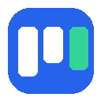

# MyBoard - World-Class Kanban New Tab & Focus Suite

MyBoard turns your browser's new tab page into a stunning, distraction-free productivity dashboard inspired by modern glassmorphism.



---

## 🌟 Key Features

1. **Exact Kanban UI**:
   - Matches the dark frosted glass aesthetic with "To Do", "In Progress", "Done", and custom columns.
   - Smooth **HTML5 Drag-and-Drop** between and within columns.
   - Click to edit any task title, column title, or board title inline.
   - **"+ New"** button at the bottom of each column for instantaneous inline card creation.
   - Color-coded priority/category badges (`Feature`, `High Priority`, `Completed`, etc.).

2. **Top Center Google Search Bar**:
   - Sleek floating glass search bar with authentic Google logo.
   - Direct search query submission to Google.
   - Intelligent URL detection (typing `github.com` or `https://...` navigates directly).
   - Instant keyboard shortcut: Press `/` or `Cmd/Ctrl + K` to focus search from anywhere.

3. **Productivity Stopwatch & Focus Timer**:
   - Positioned alongside Google Search in the top center bar.
   - Dual Modes:
     - **Stopwatch**: Count up mode (`00:00:00`) with Start / Pause / Reset.
     - **Focus Countdown (Pomodoro)**: 25-minute timer with gentle audio chime upon completion (uses Web Audio API, no external audio files required).

4. **Dynamic Wallpapers on Every New Tab**:
   - Changes wallpaper automatically every time you open a new tab!
   - 12+ curated, high-definition 4K scenic wallpapers (Tokyo Tower night skyline, Shibuya cyberpunk, Mount Fuji at dusk, Swiss Alps, Lofoten Aurora, and minimalist architecture).
   - Includes a quick **"Next Wallpaper" (🎲)** button on the top right to cycle anytime.
   - Custom Wallpaper URL support in Settings.

5. **Dark & Light Theme**:
   - Instant one-click toggle (Sun / Moon button in top right).
   - Dark theme: Dark obsidian glass (`rgba(16, 20, 30, 0.72)`) with glowing borders.
   - Light theme: Frosted crystal white glass with high-contrast text.

6. **Multi-Board Management (Collapsible Sidebar)**:
   - "My Boards" sidebar on the left.
   - Create multiple distinct project boards (e.g. Daily Board, Sprint Planning, Ideas).
   - Collapsible with `<<` button and a floating toggle button to re-open.
   - Full data persistence in browser storage (`localStorage` + `chrome.storage.local`).
   - JSON Export and Import capabilities to backup or transfer your boards.

---

## 🚀 How to Install in Google Chrome / Brave / Edge

1. Open your browser and navigate to:
   - **Chrome**: `chrome://extensions`
   - **Brave**: `brave://extensions`
   - **Edge**: `edge://extensions`
2. Enable **"Developer mode"** in the top-right corner.
3. Click the **"Load unpacked"** button in the top-left corner.
4. Select the folder:
   `/Users/macbookair/desktop/addv/kanban-newtab-extension`
5. Open a new tab (`Cmd + T` on macOS or `Ctrl + T` on Windows).
6. Click **"Keep it"** if Chrome asks if you want to keep this new tab extension.

---

## 📁 Package Structure

```
kanban-newtab-extension/
├── manifest.json       # Chrome Extension Manifest V3
├── newtab.html         # Main dashboard HTML
├── css/
│   └── styles.css      # Frosted glassmorphism, themes & responsive layouts
├── js/
│   ├── backgrounds.js  # Wallpaper rotation & custom background manager
│   ├── timer.js        # Stopwatch & Pomodoro countdown with audio chime
│   ├── search.js       # Google search & URL auto-navigation
│   ├── kanban.js       # Drag-and-drop, inline editing, and board persistence
│   └── app.js          # App lifecycle, theme switcher & settings modal
└── icons/
    ├── icon16.png
    ├── icon48.png
    └── icon128.png
```
